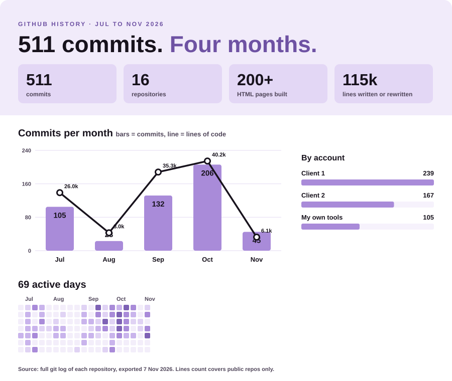

# Hi, I'm Nikki 👋

**Systems Lead and integration builder.** I design and run the whole digital stack for a UK outdoor wellness manufacturer, working remotely from South Africa: CRM, automation, integrations, email, web pages, proposals and AI agents.

## What I build

**CRM and automation (GoHighLevel)**
- Lead pipelines end to end, including Meta ad pipelines with WhatsApp quick reply openers and live transfer to the closer
- Call outcome routing: AI reads call transcripts, classifies the outcome, then writes notes, tags, tasks and a sheet row automatically
- Conversation guard that stops automated chases going out mid conversation
- Backlog re-engagement sweeper, voicemail routing, lead scoring and estimate follow-up chasers
- Self-booking call back funnel with a qualifying form that writes answers onto the contact
- Full pipeline and workflow audits, dashboard rebuild, sub account merge, role permissions

**Custom MCP server and AI agents**
- My own MCP server for GoHighLevel on Cloudflare Workers (TypeScript), giving AI full read and write access to the CRM
- Install tracker and order book sync agents
- Daily tally report combining every agent's results
- Pre-call appointment brief, conversation AI configuration, media archive tagging agent (Python)

**Integrations**
- Ecwid invoices into GHL Payments, QuickBooks to GHL, Stripe deposit flow
- Dedicated email sending domain for deliverability, Gmail sync diagnosis
- Inbound website forms wired by webhook into the CRM

**Email system**
- Master responsive email template and design system every customer email is built from
- Full customer email journey, held in one organised template library

**Web pages and sales tools**
- 200+ hosted HTML pages: product pages, brochures, deposit and estimate pages
- Custom proposal pages for commercial and private clients
- Drag and drop render layout tool and a 3D site planner
- Partner seller pack, grant service page, content and shoot plans

**Documents and training**
- Role based CRM user manual, owner guides and warranties, handover sign-off form, trade show brochures

## Stack

HTML · CSS · JavaScript · TypeScript · Python · YAML · GoHighLevel · Zapier · Cloudflare Workers · MCP · REST APIs · Webhooks · GitHub Pages · Wix · Stripe · Ecwid · QuickBooks · Resend · Playwright · Claude
